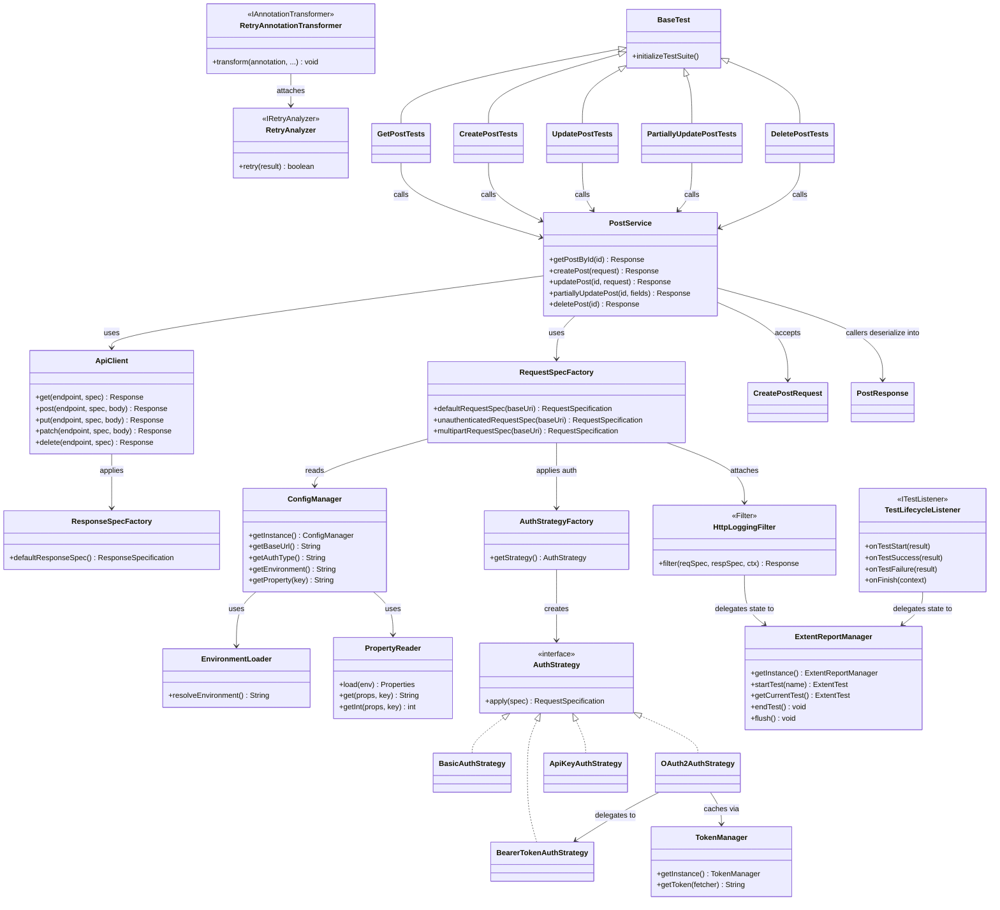
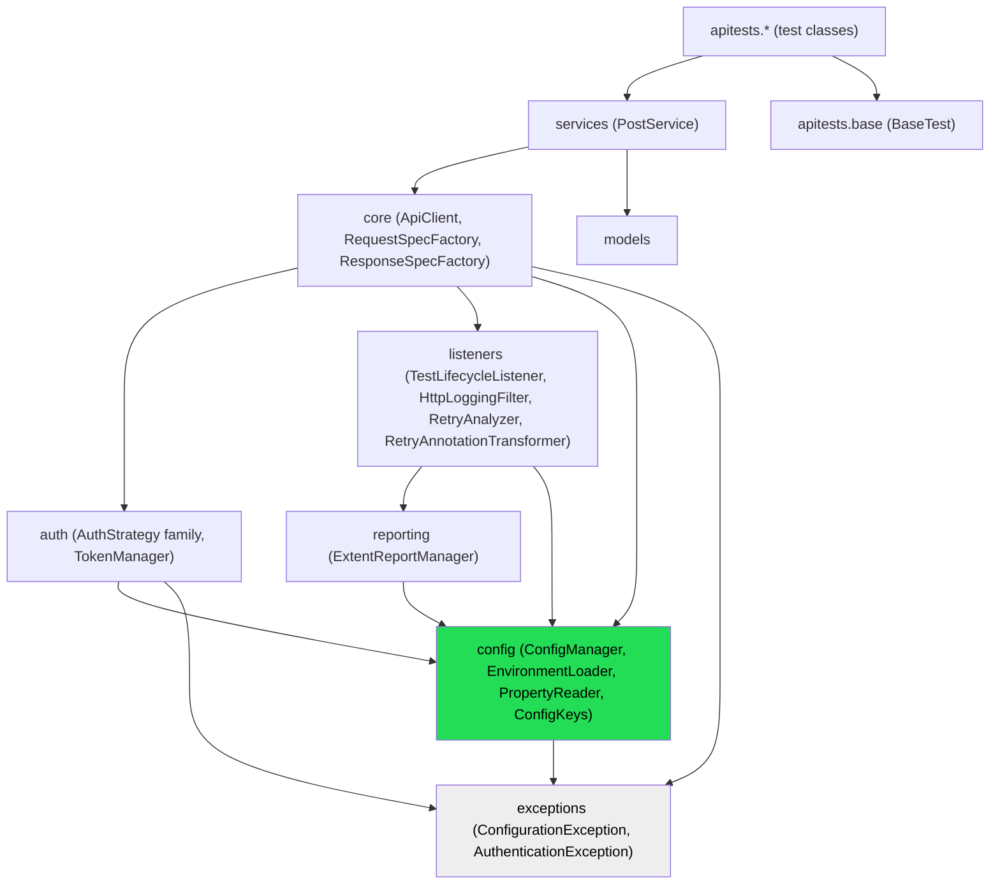

# Architecture Reference

Final state after the Architecture Review (see the review notes delivered alongside this
document for scoring, findings, and rationale). This file is the artifact of that review:
folder structure, class diagram, dependency diagram, and forward-looking suggestions.

## 1. Final Folder Structure

```
api-automation-framework/
├── pom.xml
├── mvnw, mvnw.cmd, .mvn/wrapper/maven-wrapper.properties   (pinned Maven version)
├── testng.xml                        (default suite - mirrors suites/full.xml)
├── Jenkinsfile
├── .github/workflows/api-tests.yml
├── CI-CD.md
├── ARCHITECTURE.md                   (this file)
├── README.md
├── .gitignore
│
├── src/main/java/com/org/apiautomation/
│   ├── config/          ConfigManager, ConfigKeys, EnvironmentLoader, PropertyReader
│   ├── core/             ApiClient, RequestSpecFactory, ResponseSpecFactory
│   ├── auth/             AuthStrategy, AuthStrategyFactory,
│   │                     BasicAuthStrategy, BearerTokenAuthStrategy,
│   │                     ApiKeyAuthStrategy, OAuth2AuthStrategy, TokenManager
│   ├── models/
│   │   ├── request/      CreatePostRequest
│   │   └── response/      PostResponse
│   ├── services/         PostService
│   ├── reporting/         ExtentReportManager
│   ├── listeners/         TestLifecycleListener, HttpLoggingFilter,
│   │                       RetryAnalyzer, RetryAnnotationTransformer
│   ├── exceptions/        ConfigurationException, AuthenticationException
│   ├── assertions/         (empty - no caller yet; see review)
│   ├── constants/           (empty - no caller yet)
│   └── utils/                (empty - no caller yet; see the Utilities-layer decision)
│
├── src/main/resources/
│   ├── config/            dev.properties, qa.properties, stage.properties, prod.properties
│   └── log4j2.xml
│
├── src/test/java/com/org/apitests/
│   ├── base/               BaseTest
│   ├── data/                 (empty - data providers are inline in test classes; see review)
│   ├── users/               GetPostTests, CreatePostTests, UpdatePostTests,
│   │                         PartiallyUpdatePostTests, DeletePostTests
│   ├── authentication/        (empty - ready for real module tests)
│   ├── portfolio/               (empty)
│   ├── funds/                     (empty)
│   ├── stocks/                      (empty)
│   ├── transactions/                  (empty)
│   ├── notifications/                   (empty)
│   └── common/                            (empty)
│
├── src/test/resources/
│   ├── schemas/            post-schema.json
│   ├── testdata/             (empty - no caller yet)
│   └── suites/                 smoke.xml, sanity.xml, regression.xml, full.xml
│
└── (gitignored) target/, test-output/, reports/
```

30 Java files total (24 main, 6 test). Seven of the framework's own packages are
intentionally empty — see the review's YAGNI discussion for why that's a documented decision,
not an oversight.

## 2. Final Class Diagram



## 3. Final Dependency Diagram (package level)



Single direction throughout, no cycles: `tests → services → core → {auth, listeners} → {config, reporting} → exceptions`.
`core`'s dependency on `auth` and `listeners` is one-way by construction — `auth.OAuth2AuthStrategy`
deliberately talks to Rest Assured directly instead of calling back into `core`, specifically to
avoid the cycle that would otherwise form (see its Javadoc).

## 4. Future Enhancement Suggestions

Ordered roughly by value, not by size:

1. **Unit tests for the framework's own classes.** `ConfigManager`, `PropertyReader`,
   `EnvironmentLoader`, `RetryAnalyzer`'s counting logic, `HttpLoggingFilter`'s redaction —
   none of these have a persisted, repeatable unit test today. Every verification so far was a
   real live check performed once during development and then discarded. This is the single
   biggest gap standing between this framework and "production-ready" — see the review.
2. **HTTP-level retry** for transient network failures (connection reset, timeout), distinct
   from `RetryAnalyzer`'s test-level retry. `retry.max.attempts`/`retry.delay.ms` already exist
   in every properties file, reserved for exactly this, currently unused.
3. **Body redaction**, not just headers. A login-style JSON body with a password field is
   logged in full today. Needs a field-name allow/deny list — a policy decision, not a
   mechanical fix.
4. **Runtime-configurable parallelism.** Thread counts are fixed per suite XML file today
   (TestNG's suite format doesn't support property substitution). Generating the suite XML at
   build time from a template would allow `-Dthreads=N` from the CLI/CI without editing a file.
5. **Test data cleanup.** Nothing currently tears down data a test created. Harmless against
   the public demo API (which doesn't persist anything real), but a real business module's
   tests creating real records need an `@AfterMethod`/`@AfterClass` cleanup story.
6. **A minimal `assertions.ResponseAssert`** for the handful of assertions repeated across
   every test class (status code, content-type) — noted in the review as a real, if small,
   DRY gap; deliberately not built in this pass to avoid introducing a new layer inside an
   already-large refactor.
7. **Dependency vulnerability scanning** in CI (e.g. OWASP Dependency-Check or
   `mvn versions:display-dependency-updates`) — not currently wired into either pipeline.
8. **A lightweight environment health-check** (`@BeforeSuite` ping to the target base URL)
   that fails the whole run in one clear step if the environment is unreachable, instead of
   every individual test timing out and failing separately.
